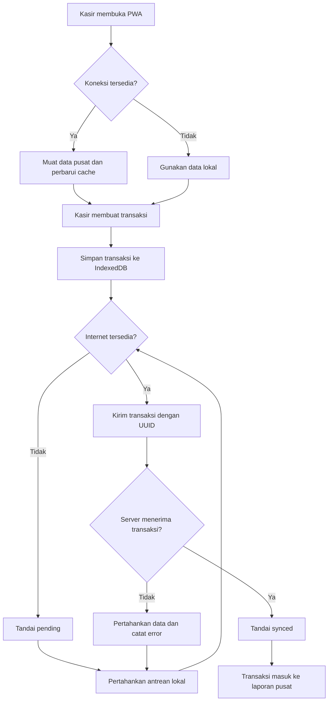

# BUSINESS REQUIREMENTS DOCUMENT (BRD)
# Sistem POS Kedai Mamah Livi

**Versi Dokumen:** 2.0  
**Tanggal:** 29 Oktober 2026  
**Jenis Sistem:** Web-Based Point of Sale (POS)  
**Model Operasional:** Offline-First  
**Database Pusat:** Supabase PostgreSQL  
**Hosting Frontend:** Cloudflare Pages Free  
**Target Pengguna:** Pemilik dan Kasir

---

# BAB I — PENDAHULUAN

## 1.1 Latar Belakang

Kedai Mamah Livi membutuhkan sistem Point of Sale (POS) untuk mendukung proses penjualan, pengelolaan menu, pencatatan pembayaran, dan pemantauan pendapatan. Penggunaan pencatatan manual atau sistem yang hanya bergantung pada koneksi internet berpotensi menghambat transaksi ketika jaringan mengalami gangguan.

Untuk mengatasi kebutuhan tersebut, Sistem POS Kedai Mamah Livi dirancang sebagai aplikasi web dengan pendekatan *offline-first*. Pendekatan ini memungkinkan fungsi transaksi utama tetap berjalan ketika perangkat kehilangan koneksi internet sementara.

Aplikasi menyimpan transaksi secara lokal pada perangkat kasir terlebih dahulu. Setelah koneksi tersedia, data transaksi akan disinkronkan dengan database pusat Supabase. Dengan demikian, transaksi tidak harus selalu menunggu server merespons untuk dapat dicatat.

Sistem menyediakan dua role pengguna, yaitu pemilik dan kasir. Pemilik bertanggung jawab atas pengelolaan akun kasir, menu, pengaturan sistem, dan pemantauan laporan. Kasir bertanggung jawab atas pelaksanaan transaksi penjualan menggunakan akun masing-masing.

Pengelolaan stok dan bahan baku tidak termasuk dalam ruang lingkup versi pertama. Fokus pengembangan adalah membangun POS yang responsif, aman, mudah digunakan, dan mampu mempertahankan proses transaksi ketika koneksi internet terputus.

## 1.2 Tujuan Bisnis

1. Mempercepat proses transaksi penjualan.
2. Mengurangi kesalahan perhitungan pembayaran dan kembalian.
3. Memungkinkan transaksi tetap dicatat ketika internet terputus.
4. Menyinkronkan transaksi lokal ke database pusat ketika koneksi pulih.
5. Mempermudah pemilik mengelola menu dan akun kasir.
6. Menyediakan laporan penjualan berdasarkan transaksi yang telah disinkronkan.
7. Mendukung penggunaan aplikasi dari HP, tablet, laptop, dan komputer.
8. Mengurangi risiko kehilangan transaksi akibat gangguan jaringan.
9. Menyediakan fondasi sistem yang dapat dikembangkan di masa mendatang.

## 1.3 Ruang Lingkup

### 1.3.1 Fitur yang termasuk dalam sistem

- Login dan autentikasi pengguna.
- Dua role: pemilik dan kasir.
- Manajemen banyak akun kasir.
- Dashboard pemilik dan kasir.
- Manajemen menu, kategori, harga, dan varian.
- Transaksi POS.
- Pembayaran tunai dan pencatatan metode pembayaran lain.
- Perhitungan subtotal, diskon, total, dan kembalian.
- Riwayat transaksi.
- Struk digital dan dukungan pencetakan.
- Laporan penjualan.
- Pengaturan kedai.
- Audit aktivitas penting.
- Progressive Web App (PWA).
- Penyimpanan transaksi lokal.
- Antrean sinkronisasi transaksi.
- Indikator status koneksi dan sinkronisasi.
- Penanganan transaksi gagal sinkron.
- Pemulihan antrean sinkronisasi setelah aplikasi dibuka kembali.

### 1.3.2 Fitur yang tidak termasuk dalam versi pertama

- Pengelolaan stok produk dan bahan baku.
- Resep atau komposisi bahan.
- Pengurangan stok otomatis.
- Sistem dapur terpisah.
- Integrasi marketplace makanan.
- Integrasi otomatis payment gateway.
- Akuntansi lengkap dan penggajian.
- Pengelolaan pelanggan dan program loyalitas tingkat lanjut.
- Transaksi offline yang langsung terlihat di seluruh perangkat lain sebelum tersinkronisasi.

## 1.4 Pemangku Kepentingan

| Pemangku Kepentingan | Tanggung Jawab |
|---|---|
| Pemilik | Mengelola menu, akun kasir, pengaturan, dan laporan |
| Kasir | Melaksanakan transaksi penjualan dan memantau status sinkronisasi |
| Pengembang | Mengimplementasikan sistem dan menguji fungsionalitas |
| Supabase | Menyediakan database pusat dan autentikasi |
| Cloudflare Pages | Menyediakan hosting frontend aplikasi |

## 1.5 Asumsi Bisnis

- Kedai memiliki koneksi internet, tetapi koneksi dapat terputus sementara.
- Setiap kasir menggunakan akun individual.
- Setiap perangkat kasir dapat memiliki transaksi lokal yang belum tersinkronisasi.
- Pengguna melakukan login online setidaknya sekali sebelum menggunakan mode offline pada perangkat tersebut.
- Menu dan data konfigurasi yang diperlukan telah tersimpan secara lokal sebelum perangkat offline.
- Sistem tidak mengelola stok sehingga transaksi tidak memerlukan validasi jumlah stok.
- Database pusat menjadi sumber data utama setelah transaksi tersinkronisasi.

---

# BAB II — ROLE DAN KEBUTUHAN FUNGSIONAL

## 2.1 Role Pengguna

Sistem hanya memiliki dua role.

### 2.1.1 Pemilik

Pemilik memiliki akses ke fungsi administrasi dan pengawasan usaha, meliputi:

- Mengakses dashboard pemilik.
- Membuat akun kasir.
- Mengubah informasi akun kasir.
- Mengaktifkan atau menonaktifkan akun kasir.
- Mengelola kategori dan menu.
- Mengatur harga serta varian menu.
- Melihat seluruh transaksi yang telah tersinkronisasi.
- Melihat laporan penjualan.
- Melihat transaksi yang belum tersinkronisasi apabila perangkat sumber dapat dijangkau.
- Mengelola pengaturan kedai.
- Melihat audit aktivitas.
- Melakukan pemeriksaan transaksi yang gagal disinkronkan.

### 2.1.2 Kasir

Kasir memiliki akses ke fungsi operasional:

- Login dan logout.
- Melihat menu yang tersedia.
- Membuat transaksi.
- Mengubah keranjang sebelum transaksi diselesaikan.
- Memilih metode pembayaran.
- Menghitung pembayaran dan kembalian.
- Melihat riwayat transaksi miliknya.
- Melihat status sinkronisasi transaksi.
- Mencetak atau menampilkan struk.
- Melihat ringkasan transaksi pribadi.

Kasir tidak dapat membuat akun baru, mengubah role, mengelola harga, mengakses seluruh laporan usaha, atau mengubah pengaturan sistem.

## 2.2 Matriks Hak Akses

| Fitur | Pemilik | Kasir |
|---|---|---|
| Login | Ya | Ya |
| Dashboard | Lengkap | Operasional |
| Transaksi POS | Ya | Ya |
| Melihat semua transaksi pusat | Ya | Tidak |
| Melihat transaksi sendiri | Ya | Ya |
| Membuat akun kasir | Ya | Tidak |
| Menonaktifkan akun kasir | Ya | Tidak |
| Mengelola menu dan harga | Ya | Tidak |
| Melihat laporan seluruh kedai | Ya | Tidak |
| Melihat status sinkronisasi | Semua transaksi pusat dan status yang tersedia | Transaksi sendiri |
| Pengaturan kedai | Ya | Tidak |
| Mengakses audit log | Ya | Tidak |

Hak akses tetap harus divalidasi di sisi server dan database. Menyembunyikan tombol pada antarmuka bukan mekanisme keamanan yang cukup.

## 2.3 Manajemen Akun Kasir

Pemilik dapat membuat dan mengelola akun kasir melalui menu Manajemen Kasir.

Kebutuhan fungsional:

1. Membuat akun baru dengan nama dan email atau identitas login yang ditetapkan.
2. Menetapkan role `kasir` secara otomatis.
3. Mengirimkan undangan atau menggunakan proses pengaturan kata sandi yang aman.
4. Menampilkan daftar akun kasir.
5. Mengubah informasi profil.
6. Menonaktifkan dan mengaktifkan kembali akun.
7. Melihat riwayat transaksi berdasarkan kasir.
8. Menolak pendaftaran publik yang dapat membuat akun pemilik tanpa izin.

Pembuatan akun harus dilakukan melalui backend tepercaya atau Supabase Edge Function yang memverifikasi hak pemilik. Kunci administratif Supabase tidak boleh berada di frontend.

Penonaktifan akun harus mencegah akses baru setelah statusnya berlaku, tetapi tidak menghapus transaksi yang telah dibuat.

## 2.4 Dashboard Pemilik

Dashboard pemilik menyediakan ringkasan bisnis:

- Total penjualan pada periode terpilih.
- Jumlah transaksi.
- Rata-rata nilai transaksi.
- Menu terlaris.
- Penjualan berdasarkan kasir.
- Penjualan berdasarkan metode pembayaran.
- Grafik penjualan harian, mingguan, dan bulanan.
- Ringkasan pembatalan dan pengembalian dana.
- Status sinkronisasi transaksi.
- Jumlah transaksi yang belum tersinkronisasi di server.
- Peringatan apabila terdapat transaksi yang gagal diproses.

Dashboard harus membedakan transaksi yang sudah tersimpan di server dan transaksi yang masih berada di perangkat kasir. Angka penjualan pusat tidak boleh memasukkan transaksi lokal yang belum diterima database pusat.

## 2.5 Dashboard Kasir

Dashboard kasir menyediakan:

- Tombol menuju halaman POS.
- Ringkasan transaksi pribadi.
- Riwayat transaksi.
- Status koneksi.
- Jumlah transaksi yang menunggu sinkronisasi.
- Jumlah transaksi yang gagal disinkronkan.
- Waktu sinkronisasi terakhir.
- Petunjuk untuk mengatasi masalah sinkronisasi.

## 2.6 Manajemen Menu

Pemilik dapat mengelola:

- Nama menu.
- Kategori.
- Deskripsi.
- Foto.
- Harga jual.
- Varian ukuran atau tambahan.
- Harga tambahan untuk varian.
- Status menu tersedia atau tidak tersedia.

Menu dapat ditambah, diubah, atau diarsipkan. Menu yang sudah digunakan pada transaksi historis tidak boleh dihapus dengan cara yang merusak riwayat.

### Kebutuhan offline menu

Saat perangkat masih online, aplikasi harus menyimpan salinan lokal dari menu dan harga yang dibutuhkan untuk transaksi. Perubahan menu di server akan diperbarui pada perangkat ketika koneksi tersedia.

Jika perangkat offline, aplikasi menggunakan salinan lokal terakhir yang berhasil disinkronkan.

Sistem harus menampilkan informasi waktu pembaruan menu terakhir. Harga yang digunakan pada transaksi offline disimpan sebagai snapshot agar perubahan harga berikutnya tidak mengubah transaksi yang sudah dibuat.

---

# BAB III — KEBUTUHAN TRANSAKSI POS

## 3.1 Fitur Point of Sale

Fitur POS meliputi:

1. Menampilkan menu dan kategori.
2. Mencari menu berdasarkan nama.
3. Memilih varian atau tambahan.
4. Menambahkan menu ke keranjang.
5. Mengubah jumlah item.
6. Menghapus item sebelum transaksi diselesaikan.
7. Menghitung subtotal.
8. Menghitung diskon jika diizinkan.
9. Menghitung total pembayaran.
10. Memilih metode pembayaran.
11. Memasukkan nominal pembayaran tunai.
12. Menghitung kembalian.
13. Menyimpan transaksi.
14. Membuat nomor identitas transaksi.
15. Menampilkan dan mencetak struk.

Perhitungan total dan validasi transaksi harus dilakukan dengan mekanisme yang tepercaya. Aplikasi tidak boleh hanya mengandalkan angka total yang dikirim oleh browser.

## 3.2 Aturan Transaksi

- Setiap transaksi memiliki UUID unik.
- Setiap transaksi mencatat identitas kasir.
- Setiap item menyimpan nama dan harga saat transaksi.
- Transaksi yang telah selesai tidak dapat diedit tanpa prosedur koreksi yang tercatat.
- Pengiriman ulang permintaan yang sama tidak boleh membuat transaksi ganda.
- Transaksi batal tidak dihitung sebagai penjualan berhasil.
- Pengembalian dana harus dicatat terpisah.
- Transaksi lokal harus memiliki status sinkronisasi.
- Transaksi tidak boleh dihapus hanya karena proses sinkronisasi gagal.

## 3.3 Pembayaran

Metode pembayaran versi pertama:

- Tunai.
- QRIS dengan pencatatan manual.
- Transfer atau metode lain yang dikonfigurasi pemilik.

### Aturan pembayaran offline

**Tunai:** transaksi dapat diselesaikan secara lokal ketika offline, dengan pencatatan nominal uang diterima dan kembalian.

**QRIS dan transfer:** ketika offline, aplikasi tidak dapat memastikan bahwa pembayaran digital benar-benar diterima. Transaksi dapat disimpan sebagai menunggu verifikasi, tetapi tidak boleh dianggap sebagai pembayaran digital terverifikasi sebelum statusnya dikonfirmasi secara online.

Integrasi payment gateway otomatis tidak termasuk dalam versi pertama.

## 3.4 Struk Transaksi

Struk mencakup:

- Nama kedai.
- Nomor transaksi.
- Tanggal dan waktu.
- Nama kasir.
- Daftar item.
- Jumlah dan harga.
- Diskon jika ada.
- Total pembayaran.
- Metode pembayaran.
- Nominal diterima dan kembalian jika relevan.
- Status transaksi.

Untuk transaksi offline, struk dapat diberi label bahwa transaksi belum tersinkronisasi ke server. Pencetakan fisik bergantung pada dukungan browser, sistem operasi, dan printer yang digunakan.

---

# BAB IV — KEBUTUHAN OFFLINE-FIRST

## 4.1 Tujuan Offline-First

Sistem harus mengutamakan ketersediaan fungsi transaksi lokal sehingga koneksi internet tidak menjadi syarat mutlak untuk setiap transaksi.

Aplikasi perlu tetap dapat dibuka setelah pernah dimuat dan dipersiapkan saat online. Data transaksi baru disimpan terlebih dahulu ke penyimpanan lokal yang mendukung operasi database, kemudian dikirim ke server ketika koneksi tersedia.

Offline-first tidak berarti semua fitur tersedia tanpa internet. Fungsi yang membutuhkan database pusat atau verifikasi eksternal tetap memerlukan koneksi.

## 4.2 Fitur Offline

### OF-01 — Aplikasi dapat dibuka offline

Aplikasi menggunakan Service Worker untuk menyimpan aset aplikasi yang diperlukan, seperti HTML, JavaScript, CSS, ikon, dan halaman utama.

Setelah aplikasi berhasil dimuat dan di-cache saat online, pengguna dapat membukanya kembali ketika koneksi internet terputus.

### OF-02 — Database lokal

Aplikasi menggunakan IndexedDB untuk menyimpan data operasional lokal, meliputi:

- Salinan menu dan kategori.
- Varian menu.
- Pengaturan yang diperlukan untuk transaksi.
- Transaksi yang dibuat secara lokal.
- Detail item transaksi.
- Status pembayaran lokal.
- Antrean sinkronisasi.
- Status dan waktu sinkronisasi.

IndexedDB lebih sesuai daripada `localStorage` untuk data transaksi terstruktur yang perlu disimpan secara konsisten.

### OF-03 — Transaksi offline

Kasir dapat:

1. Membuka aplikasi yang sudah dipersiapkan sebelumnya.
2. Melihat menu yang tersimpan lokal.
3. Membuat keranjang.
4. Menyelesaikan transaksi tunai.
5. Menyimpan transaksi dan rincian item ke IndexedDB.
6. Mendapatkan nomor identitas lokal.
7. Melihat transaksi pada riwayat lokal.
8. Melanjutkan transaksi lain tanpa menunggu koneksi pulih.

Penyimpanan transaksi lokal harus berhasil sebelum aplikasi menampilkan konfirmasi bahwa transaksi telah tercatat.

### OF-04 — Antrean sinkronisasi

Setiap transaksi offline masuk ke antrean sinkronisasi dengan status:

- `pending`: menunggu sinkronisasi.
- `syncing`: sedang dikirim.
- `synced`: sudah diterima dan dikonfirmasi server.
- `failed`: gagal diproses dan memerlukan penanganan.

Status `failed` tidak berarti transaksi boleh dihapus. Data harus tetap tersimpan sampai masalahnya diselesaikan.

### OF-05 — Sinkronisasi otomatis

Ketika koneksi kembali tersedia, aplikasi mencoba mengirim transaksi yang belum tersinkronisasi.

Pemicu sinkronisasi dapat berupa:

- Perubahan status koneksi.
- Aplikasi kembali aktif.
- Pengguna membuka halaman POS.
- Pengguna menekan tombol sinkronisasi.
- Mekanisme pemeriksaan berkala saat aplikasi aktif.

Service Worker Background Sync dapat digunakan jika didukung browser, tetapi sistem tidak boleh bergantung sepenuhnya pada fitur tersebut. Sinkronisasi juga harus dapat dilanjutkan ketika aplikasi dibuka kembali.

### OF-06 — Sinkronisasi manual

Kasir dapat menekan tombol Sinkronkan Sekarang.

Aplikasi menampilkan:

- Jumlah transaksi yang menunggu.
- Jumlah transaksi yang berhasil dikirim.
- Jumlah transaksi yang gagal.
- Waktu sinkronisasi terakhir.
- Pesan kesalahan yang dapat dipahami pengguna.

### OF-07 — Pencegahan transaksi ganda

Setiap transaksi lokal harus mempunyai UUID yang tetap sama pada setiap percobaan pengiriman.

Database pusat menggunakan batasan unik dan proses penyimpanan yang idempoten. Jika transaksi yang sama dikirim kembali akibat jaringan terputus setelah server menyimpan data, server harus mengembalikan hasil transaksi yang sudah ada, bukan membuat transaksi baru.

### OF-08 — Konflik data

Transaksi penjualan tidak boleh ditimpa oleh perubahan menu atau data dari perangkat lain.

Aturan konflik:

- Transaksi yang sudah dibuat mempertahankan harga dan nama item pada saat transaksi.
- Transaksi lokal yang valid tidak boleh hilang akibat sinkronisasi.
- Menu terbaru dari server dapat menggantikan salinan menu lokal untuk transaksi berikutnya.
- Perubahan harga tidak mengubah transaksi lama.
- Konflik status pembayaran atau pembatalan harus ditangani melalui aturan bisnis dan audit, bukan dengan menimpa data secara sembarang.

### OF-09 — Pemulihan aplikasi

Jika browser ditutup atau perangkat dimulai ulang ketika terdapat transaksi pending:

- Transaksi tetap tersimpan di IndexedDB.
- Antrean sinkronisasi dipulihkan saat aplikasi dibuka kembali.
- Transaksi yang belum terkirim akan dicoba kembali.
- Transaksi yang sudah dikonfirmasi server tidak dibuat ulang.
- Pengguna dapat melihat transaksi yang masih menunggu.

### OF-10 — Indikator status

Aplikasi harus menampilkan indikator yang jelas:

- Online.
- Offline.
- Sinkronisasi berlangsung.
- Semua transaksi tersinkronisasi.
- Ada transaksi menunggu.
- Sinkronisasi gagal.

Status harus ditentukan dari kondisi koneksi dan hasil permintaan server, bukan hanya berdasarkan indikator jaringan browser.

## 4.3 Batasan Offline

Ketika offline, sistem tidak dapat menjamin bahwa:

- Pemilik langsung melihat transaksi dari perangkat kasir lain.
- Perubahan menu dari perangkat lain langsung diterima.
- Pembayaran QRIS atau transfer telah diterima.
- Akun yang baru dinonaktifkan di server langsung diblokir pada perangkat yang sedang offline.
- Semua fitur laporan pusat tersedia dengan data terbaru.

Transaksi offline yang tersimpan pada perangkat hanya dapat disinkronkan setelah perangkat tersebut kembali terhubung. Jika perangkat hilang atau data browser dihapus sebelum sinkronisasi, transaksi yang belum terkirim dapat hilang. Karena itu, data lokal perlu dipertahankan dan status pending harus ditampilkan secara jelas.

---

# BAB V — ARSITEKTUR TEKNIS

## 5.1 Teknologi yang Direkomendasikan

| Komponen | Teknologi | Fungsi |
|---|---|---|
| Frontend | React + Vite | Antarmuka POS dan dashboard |
| UI | Tailwind CSS | Desain responsif |
| PWA | Web App Manifest + Service Worker | Instalasi dan cache aplikasi |
| Database lokal | IndexedDB | Penyimpanan menu dan transaksi offline |
| Pengelolaan IndexedDB | Dexie.js atau pustaka sejenis | Akses database lokal |
| Database pusat | Supabase PostgreSQL | Penyimpanan data terpusat |
| Autentikasi | Supabase Auth | Login pengguna |
| Keamanan data | Supabase RLS | Pembatasan akses |
| Fungsi tepercaya | Supabase Edge Functions atau mekanisme database yang aman | Pembuatan akun dan operasi sensitif |
| Hosting | Cloudflare Pages Free | Publikasi frontend |

## 5.2 Arsitektur Sistem

```text
       Pemilik / Kasir
              |
       Browser / PWA
              |
     +--------+--------+
     |                 |
 Aplikasi Online   Mode Offline
     |                 |
     |              IndexedDB
     |                 |
     |           Antrean Transaksi
     |                 |
     +------ Sinkronisasi ------+
                                |
                       Supabase Auth
                                |
                       Backend Tepercaya
                                |
                       PostgreSQL Pusat
```

Cloudflare Pages berfungsi sebagai hosting frontend. Supabase menjadi pusat data dan autentikasi. IndexedDB menyimpan data lokal untuk kebutuhan offline.

## 5.3 Persyaratan Keamanan Lokal

- Jangan menyimpan password pengguna di IndexedDB.
- Jangan menyimpan secret key administratif Supabase di browser.
- Data lokal harus dikaitkan dengan akun dan perangkat yang menggunakannya.
- Transaksi lokal harus tetap memiliki identitas kasir yang jelas.
- Aplikasi harus menangani sesi login yang kedaluwarsa.
- Login offline hanya dapat dilakukan pada perangkat yang sebelumnya telah disiapkan secara online dan memiliki sesi atau mekanisme autentikasi lokal yang dirancang aman.
- Jika sesi tidak lagi sah, sistem tidak boleh menganggap transaksi yang disinkronkan otomatis telah diotorisasi tanpa validasi server.
- Kebijakan RLS wajib membatasi akses ke data pusat.

Penyimpanan lokal pada browser tidak memberikan perlindungan setara dengan database server. Untuk perangkat kasir bersama, akses perangkat harus dibatasi dan mekanisme penguncian aplikasi perlu dipertimbangkan.

## 5.4 Sinkronisasi Transaksi

Urutan sinkronisasi:

1. Aplikasi membaca transaksi berstatus `pending`.
2. Aplikasi memeriksa sesi pengguna dan koneksi.
3. Transaksi dikirim dengan UUID tetap.
4. Backend memvalidasi identitas, role, struktur item, harga yang berlaku menurut aturan transaksi, dan total.
5. Database menyimpan transaksi secara atomik.
6. Server mengembalikan identitas transaksi pusat.
7. Aplikasi menandai transaksi sebagai `synced`.
8. Jika proses gagal, transaksi tetap tersimpan lokal dan dicoba kembali sesuai jenis kesalahan.

Satu transaksi beserta item dan pembayaran yang terkait harus disimpan menggunakan mekanisme yang menjaga konsistensi database.

---

# BAB VI — RANCANGAN DATABASE

## 6.1 Tabel Utama Supabase

| Tabel | Fungsi |
|---|---|
| `profiles` | Profil pengguna dan role |
| `categories` | Kategori menu |
| `products` | Menu, harga, foto, dan ketersediaan |
| `product_variants` | Varian atau tambahan menu |
| `orders` | Data utama transaksi |
| `order_items` | Rincian item transaksi |
| `payments` | Informasi pembayaran |
| `cash_shifts` | Shift dan pencatatan kas jika digunakan |
| `audit_logs` | Aktivitas penting |
| `store_settings` | Konfigurasi kedai |

Tidak ada tabel stok, bahan baku, resep, atau pergerakan stok pada versi pertama.

## 6.2 Data Lokal IndexedDB

Database lokal setidaknya memiliki object store berikut:

| Object Store | Fungsi |
|---|---|
| `cached_products` | Salinan menu dan kategori |
| `cached_settings` | Konfigurasi lokal yang dibutuhkan |
| `local_orders` | Transaksi yang dibuat perangkat |
| `local_order_items` | Detail item transaksi lokal |
| `sync_queue` | Antrean sinkronisasi |
| `sync_metadata` | Status dan waktu sinkronisasi |

Data lokal harus mempunyai identitas perangkat dan transaksi yang unik. Struktur lokal dapat disesuaikan selama seluruh data yang belum tersinkronisasi dapat dipulihkan.

## 6.3 Kolom Penting Transaksi

Tabel `orders` setidaknya menyimpan:

- `id`: UUID transaksi.
- `server_order_number`: nomor transaksi pusat.
- `cashier_id`: pengguna yang membuat transaksi.
- `device_id`: identitas perangkat sumber.
- `created_at_local`: waktu transaksi menurut perangkat.
- `received_at_server`: waktu penerimaan oleh server.
- `subtotal`.
- `discount_amount`.
- `total_amount`.
- `payment_status`.
- `order_status`.
- `sync_metadata` atau status lain yang relevan di sisi lokal.

Tabel `order_items` menyimpan:

- Identitas item.
- Identitas transaksi.
- Identitas produk jika tersedia.
- Nama produk saat transaksi.
- Varian yang dipilih.
- Jumlah item.
- Harga satuan saat transaksi.
- Diskon item jika ada.
- Subtotal.

Nomor transaksi lokal dapat digunakan sebelum server memberikan nomor resmi. Sistem harus menyimpan pemetaan antara UUID lokal dan nomor transaksi pusat.

Waktu lokal dan waktu penerimaan server perlu dibedakan karena keduanya dapat berbeda ketika perangkat offline.

## 6.4 Aturan Integritas Data

- UUID transaksi harus unik.
- Setiap item terhubung dengan transaksi yang benar.
- Harga dan nama menu historis disimpan sebagai snapshot.
- Total diverifikasi berdasarkan item yang tersimpan.
- Transaksi tidak dibuat dua kali akibat pengiriman ulang.
- Role pengguna tidak dapat diubah sendiri oleh kasir.
- RLS diterapkan pada tabel yang dapat diakses dari frontend.
- Operasi sensitif menggunakan backend tepercaya.
- Transaksi yang belum tersinkronisasi tidak boleh dihapus otomatis.

---

# BAB VII — KEBUTUHAN NONFUNGSIONAL

| Aspek | Persyaratan |
|---|---|
| Performa | Halaman utama ditargetkan terbuka dalam ≤ 3 detik pada kondisi normal |
| Offline | Transaksi tunai dapat dicatat tanpa koneksi setelah aplikasi dipersiapkan |
| Konsistensi | Transaksi lokal dan pusat memiliki identitas yang tetap |
| Keandalan | Pengiriman ulang tidak menyebabkan transaksi ganda |
| Pemulihan | Antrean transaksi tetap tersedia setelah aplikasi dibuka kembali |
| Responsivitas | Mendukung HP, tablet, laptop, dan desktop |
| Keamanan | Autentikasi, RLS, validasi server, dan perlindungan secret key |
| Auditabilitas | Aktivitas sensitif dicatat |
| Pemeliharaan | Struktur kode modular dan terdokumentasi |
| Skalabilitas | Mendukung banyak akun kasir dan perangkat |
| Integritas | Transaksi dan item tersimpan secara konsisten |
| Keterlacakan | Status lokal dan pusat dapat dibedakan dengan jelas |

Target performa harus divalidasi melalui pengujian. Ketahanan offline juga bergantung pada browser, penyimpanan perangkat, dan kebijakan sistem operasi.

---

# BAB VIII — ALUR BISNIS

## 8.1 Alur Transaksi Online

1. Kasir login.
2. Sistem memuat menu dan menyimpan salinan lokal.
3. Kasir memilih menu dan jumlah.
4. Sistem menghitung subtotal dan total.
5. Kasir memproses pembayaran.
6. Transaksi disimpan dan dikonfirmasi oleh server.
7. Sistem menampilkan struk.
8. Transaksi tersedia dalam laporan pusat.

## 8.2 Alur Transaksi Offline

1. Kasir membuka aplikasi yang sudah dipersiapkan sebelumnya.
2. Aplikasi mendeteksi koneksi tidak tersedia.
3. Kasir memilih menu dari data lokal.
4. Kasir membuat transaksi dan menyelesaikan pembayaran tunai.
5. Aplikasi menyimpan transaksi ke IndexedDB.
6. Aplikasi memberikan nomor identitas transaksi lokal.
7. Transaksi ditampilkan sebagai menunggu sinkronisasi.
8. Ketika internet pulih, aplikasi mengirim transaksi ke server.
9. Server memvalidasi dan menyimpan transaksi.
10. Aplikasi menandai transaksi sebagai tersinkronisasi.
11. Transaksi masuk ke laporan pusat.

## 8.3 Diagram Offline-First



## 8.4 Alur Pemulihan Sinkronisasi

Jika jaringan terputus saat transaksi dikirim:

1. Aplikasi mempertahankan UUID transaksi.
2. Status transaksi tidak langsung dianggap berhasil.
3. Aplikasi memeriksa kembali status melalui server ketika koneksi pulih.
4. Jika transaksi sudah tersimpan, aplikasi memperbarui status lokal.
5. Jika belum tersimpan, aplikasi mengirim ulang transaksi dengan UUID yang sama.
6. Jika server mengembalikan kesalahan validasi, transaksi ditandai gagal dan ditampilkan untuk pemeriksaan.
7. Transaksi gagal tidak dihapus otomatis.

---

# BAB IX — PENGUJIAN DAN KRITERIA PENERIMAAN

Sistem harus melewati pengujian berikut sebelum digunakan secara operasional.

| ID | Skenario | Kriteria keberhasilan |
|---|---|---|
| AC-01 | Pemilik login | Dashboard pemilik dapat diakses |
| AC-02 | Membuat akun kasir | Akun baru memiliki role kasir |
| AC-03 | Kasir membuka menu | Menu yang tersimpan lokal dapat digunakan |
| AC-04 | Transaksi online | Transaksi tersimpan di server |
| AC-05 | Transaksi offline | Transaksi tunai tersimpan di IndexedDB |
| AC-06 | Aplikasi ditutup ketika offline | Transaksi pending tetap tersedia saat aplikasi dibuka kembali |
| AC-07 | Internet pulih | Transaksi pending dikirim secara otomatis atau melalui sinkronisasi manual |
| AC-08 | Permintaan dikirim ulang | Tidak ada transaksi ganda |
| AC-09 | Sinkronisasi gagal | Data tetap tersedia dan status gagal terlihat |
| AC-10 | Harga menu berubah | Transaksi lama mempertahankan harga historis |
| AC-11 | Pembayaran QRIS offline | Transaksi tidak dianggap terverifikasi sebelum dikonfirmasi |
| AC-12 | Akses role | Kasir tidak dapat mengakses fungsi khusus pemilik |
| AC-13 | Banyak perangkat | Transaksi dari perangkat berbeda dapat disinkronkan tanpa duplikasi |
| AC-14 | Laporan | Hanya transaksi dengan status yang sesuai dihitung |
| AC-15 | Cache aplikasi | Aplikasi dapat dibuka offline setelah dipersiapkan |
| AC-16 | Pemulihan data | Data pusat dapat dipulihkan dari cadangan yang tersedia |

Pengujian offline perlu mencakup pemutusan internet secara mendadak, browser ditutup, perangkat dimulai ulang, token kedaluwarsa, dan server menerima transaksi tetapi responsnya tidak sampai ke perangkat.

---

# BAB X — DEPLOYMENT DAN INFRASTRUKTUR

## 10.1 Rekomendasi Hosting Gratis

| Komponen | Layanan | Kegunaan |
|---|---|---|
| Frontend | Cloudflare Pages Free | Hosting aplikasi React |
| Database | Supabase Free | PostgreSQL terpusat |
| Autentikasi | Supabase Auth | Login pemilik dan kasir |
| Penyimpanan offline | IndexedDB | Transaksi lokal |
| Cache aplikasi | Service Worker | Menyimpan aset PWA |
| Repository | GitHub | Pengelolaan source code |

Layanan gratis digunakan selama pemakaian memenuhi batas kuota dan kebijakan penyedia. Sistem harus dirancang agar tidak bergantung pada layanan berbayar untuk fungsi dasar, tetapi kuota dan ketersediaan layanan tetap perlu dipantau.

## 10.2 Tahapan Deployment

1. Membuat proyek Supabase.
2. Membuat skema database dan kebijakan RLS.
3. Membuat proses setup akun pemilik.
4. Mengembangkan frontend React dan Vite.
5. Mengimplementasikan IndexedDB dan antrean sinkronisasi.
6. Membuat Service Worker dan konfigurasi PWA.
7. Menyimpan source code di GitHub.
8. Menghubungkan repository ke Cloudflare Pages.
9. Mengatur URL Supabase dan publishable key melalui environment variables.
10. Menguji login, transaksi online, transaksi offline, dan pemulihan sinkronisasi.
11. Mempublikasikan aplikasi dan melakukan uji operasional.

## 10.3 Backup dan Pemulihan

- Data pusat harus memiliki prosedur pencadangan.
- Cadangan harus disimpan sesuai kemampuan dan batas paket layanan.
- Pemulihan perlu diuji secara berkala.
- Data transaksi lokal tidak boleh dianggap sebagai cadangan permanen.
- Transaksi lokal harus disinkronkan sesegera mungkin ketika koneksi tersedia.
- Pemilik harus dapat mengetahui apakah masih terdapat transaksi yang belum tersinkronisasi.

---

# BAB XI — RISIKO DAN MITIGASI

| Risiko | Mitigasi |
|---|---|
| Perangkat hilang sebelum sinkronisasi | Sinkronkan sesegera mungkin dan batasi penggunaan perangkat |
| Browser menghapus penyimpanan lokal | Pantau transaksi pending dan uji penyimpanan pada perangkat target |
| Transaksi ganda | UUID unik dan operasi idempoten |
| Perbedaan harga | Snapshot harga dan waktu pembaruan menu |
| Sesi kedaluwarsa | Validasi sesi dan kebijakan penggunaan offline yang jelas |
| Pembayaran digital tidak terverifikasi | Jangan tandai lunas sebelum konfirmasi |
| Koneksi tidak stabil | Retry dengan backoff dan sinkronisasi manual |
| Proyek Supabase dijeda atau kuota habis | Pantau kuota dan sediakan prosedur pemulihan layanan |
| Konflik pembatalan | Audit log dan aturan pembatalan yang konsisten |
| Perbedaan waktu perangkat | Simpan waktu lokal dan waktu penerimaan server secara terpisah |

---

# BAB XII — TAHAPAN PENGEMBANGAN

| Tahap | Pekerjaan | Hasil |
|---|---|---|
| 1 | Finalisasi kebutuhan | BRD disetujui |
| 2 | Desain UI/UX | Rancangan dashboard dan POS |
| 3 | Fondasi database | Supabase, tabel, Auth, RLS |
| 4 | Autentikasi | Login pemilik dan banyak akun kasir |
| 5 | Manajemen menu | Kategori, produk, harga, dan varian |
| 6 | POS online | Transaksi, pembayaran, dan struk |
| 7 | PWA | Manifest dan Service Worker |
| 8 | Offline storage | IndexedDB dan penyimpanan transaksi lokal |
| 9 | Sinkronisasi | Antrean, UUID, retry, dan penanganan konflik |
| 10 | Laporan | Dashboard dan laporan penjualan |
| 11 | Pengujian | Pengujian online, offline, keamanan, dan pemulihan |
| 12 | Deployment | Publikasi dan uji operasional |

---

# BAB XIII — KESIMPULAN

Sistem POS Kedai Mamah Livi dirancang sebagai aplikasi web multi-perangkat dengan dua role, yaitu pemilik dan kasir. Sistem menggunakan Supabase sebagai database pusat serta Cloudflare Pages untuk publikasi frontend.

Fitur utama sistem adalah manajemen akun kasir, manajemen menu, transaksi POS, laporan penjualan, dan dukungan offline-first. Ketika internet terputus, kasir dapat menyimpan transaksi tunai ke database lokal. Setelah koneksi pulih, transaksi dikirim ke server dengan mekanisme yang mencegah duplikasi dan mempertahankan konsistensi data.

Pengelolaan stok, bahan baku, dan dapur tidak termasuk dalam versi pertama. Fokus utama adalah menghasilkan sistem transaksi yang mudah digunakan, aman, dapat diakses lintas perangkat, dan mampu menghadapi gangguan koneksi internet.

BRD ini menjadi acuan untuk menyusun Software Requirements Specification (SRS), desain UI/UX, struktur database Supabase, kebijakan keamanan, dan implementasi aplikasi.

**Catatan implementasi:** Offline-first harus diuji secara khusus pada browser dan perangkat yang benar-benar akan digunakan. Aplikasi web dapat menyimpan transaksi secara lokal, tetapi tidak dapat menjamin bahwa data yang belum tersinkronisasi tetap aman jika penyimpanan browser dihapus atau perangkat rusak. Oleh karena itu, indikator transaksi pending dan prosedur sinkronisasi merupakan bagian wajib dari sistem.
